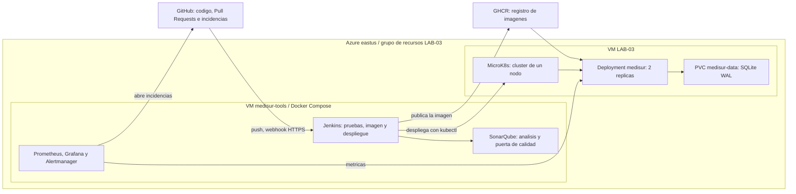

# MediSur, S.A. de C.V. — Piloto de integración y despliegue continuo

## 1. Portada

| Dato | Contenido |
| --- | --- |
| Proyecto | Piloto de CI/CD para MediSur, S.A. de C.V. |
| Materia | Cómputo en la Nube |
| Grupo | [completar] |
| Docente | [completar] |
| Fecha de entrega | 19 de noviembre de 2026 |
| Repositorio | https://github.com/SergioMultimedios/medisur-cicd |

Integrantes y roles:

| Integrante | Matrícula | Rol en el equipo |
| --- | --- | --- |
| Diego Garza Avalos | 2066114 | Infraestructura en Azure |
| Sergio Guillermo Navarro Ayala | 2069392 | Pipeline y calidad |
| Luis Andrés Salinas Lozano | 2277561 | Aplicación y pruebas |
| Andrés Monsiváis Salazar | 2066077 | Monitoreo y documentación |

El video de respaldo de 10 a 15 minutos queda [completar].

## 2. Problemática y objetivo

MediSur publica sus cambios a mano. Alguien entra por SSH el sábado, copia archivos, reinicia servicios y vigila el resultado; cada publicación toma entre dos y tres horas. No hay pruebas automáticas ni revisión de código entre compañeros, así que el único filtro antes de producción es la atención de quien despliega. Uno de cada cuatro despliegues termina revertido. Cuando algo falla no existe forma de saberlo antes que el usuario: no hay monitoreo. El resultado es que el 41 % de los cambios entra clasificado como emergencia, lo que significa que casi la mitad del trabajo de la empresa se publica sin pasar por ningún control.

Lo que resolvemos en este piloto es la cadena entre un cambio de código y la versión que atiende peticiones. Cada push a la rama principal dispara pruebas, análisis de calidad, construcción de imagen, publicación y despliegue, y al final podemos preguntarle a la aplicación qué commit está sirviendo. Si las pruebas o la calidad no cumplen, el proceso se detiene antes de construir la imagen. Si el despliegue no termina bien, el sistema regresa solo a la versión anterior. El monitoreo informa del estado de las dos máquinas virtuales y de la aplicación, y tres alertas abren una incidencia en el repositorio sin que nadie tenga que mirar un tablero.

La aplicación del piloto es una API pequeña en Python con Flask. Expone `GET /health`, `GET /ready`, `GET /version`, `GET /metrics`, `GET /api/items` y `POST /api/items`. Es suficiente para demostrar el proceso completo con datos sintéticos; no sustituye a los sistemas clínicos de MediSur ni maneja información de pacientes.

## 3. Diagrama de arquitectura

El diagrama se lee de izquierda a derecha siguiendo el camino de un cambio. Un push al repositorio en GitHub llega por webhook HTTPS a Jenkins, que corre en la VM `medisur-tools`. Jenkins ejecuta las pruebas, manda el código y el informe de cobertura a SonarQube y espera el resultado de la puerta de calidad. Si la puerta aprueba y la rama es `main`, construye la imagen, la publica en GitHub Container Registry y aplica el despliegue en el clúster de MicroK8s que vive en la VM `LAB-03`. El clúster descarga la imagen desde el registro con una credencial propia y hace la actualización gradual del Deployment.

La columna derecha es el clúster. El Deployment mantiene dos réplicas que reciben tráfico por un Service ClusterIP y, para pruebas desde la red privada, por un Service NodePort en el puerto 30081. Ambas réplicas comparten el PersistentVolumeClaim `medisur-data`, donde SQLite guarda los datos en modo WAL.

Las flechas verdes son el monitoreo y van en sentido contrario al de la entrega. Prometheus, Grafana y Alertmanager corren juntos en `medisur-tools`. Prometheus consulta las métricas de los dos pods uno por uno a través del servidor de API del clúster, además de `kube-state-metrics`, `cAdvisor` y el `node_exporter` de cada VM. Grafana consulta a Prometheus y Prometheus manda las alertas a Alertmanager, que a su vez las entrega a un servicio propio que abre y cierra incidencias en el mismo repositorio donde está el código.

Convenciones del diagrama: los dos rectángulos interiores son máquinas virtuales y el rectángulo exterior es el grupo de recursos de Azure; los nodos de fuera —GitHub y GHCR— son servicios administrados que no corren en nuestra suscripción; el azul marca el flujo de entrega y el verde el de monitoreo. Las versiones de cada componente están en la sección 4 y sus direcciones en la sección 5.

El diagrama editable está en `docs/architecture.drawio`, por si hay que modificarlo sin regenerar el documento completo.

## 4. Inventario de aplicaciones y herramientas

Las herramientas corren como contenedores con Docker Compose en la VM `medisur-tools`. Sus puertos de administración se publican solamente en `127.0.0.1` y se alcanzan por túnel SSH, de modo que ninguna interfaz administrativa queda expuesta a Internet.

| Nombre | Versión | Categoría | Dónde corre | Para qué se usó | Por qué esa y no otra | Licencia / costo |
| --- | --- | --- | --- | --- | --- | --- |
| GitHub | servicio administrado | Repositorio de código | Servicio externo | Alojar el código, el Jenkinsfile y los manifiestos; proteger `main`; recibir las incidencias de alertas | Las reglas de protección de rama, la API de incidencias y el registro de imágenes vienen en el mismo servicio, sin instalar nada. Se descartó GitLab autoalojado porque habría consumido una de las dos VM del piloto | Plan gratuito |
| GitHub Container Registry | servicio administrado | Registro de imágenes | Servicio externo | Guardar las 12 versiones publicadas de la imagen de la aplicación | Usa las mismas credenciales del repositorio y permite paquetes privados. Se descartó Azure Container Registry porque suma costo mensual al presupuesto | Gratuito para paquetes privados en este volumen |
| Jenkins | 2.580.2 LTS (JDK 21) | Automatización del pipeline | Contenedor en `medisur-tools` | Ejecutar el pipeline declarativo del Jenkinsfile | Permite tener el pipeline versionado en el repositorio y las credenciales fuera de él, y corre completo en nuestra propia VM. Se descartó GitHub Actions porque el requisito del caso es operar la infraestructura de CI, no delegarla | Libre (MIT) |
| SonarQube Community | 25.12.0.117093 | Análisis estático y puerta de calidad | Contenedor en `medisur-tools` | Medir cobertura, bugs y vulnerabilidades, y decidir si el pipeline continúa | Trae la puerta de calidad como objeto configurable y Jenkins puede esperar su veredicto con `waitForQualityGate`. Se descartó usar solo `flake8` y `bandit` porque dan reportes, no una decisión que detenga el pipeline | Libre (LGPL), edición Community |
| PostgreSQL | 17.7 | Base de datos de SonarQube | Contenedor en `medisur-tools` | Almacenar proyectos, mediciones e historial de SonarQube | Es la base soportada por SonarQube para uso persistente. Se descartó la base embebida H2 porque SonarQube la limita a pruebas y pierde el historial | Libre (PostgreSQL License) |
| SonarScanner CLI | 7.3.0.5189 | Cliente de análisis | Contenedor efímero en `medisur-tools` | Enviar el código y el `coverage.xml` al servidor de SonarQube | Funciona con cualquier lenguaje sin depender del sistema de construcción. Se descartó el plugin de Maven porque el proyecto es Python | Libre (LGPL) |
| Docker Engine | 29.10.0 | Contenedores | `medisur-tools` | Correr las herramientas y construir las imágenes de pruebas y de ejecución | La construcción de dos etapas y el fijado por digest se resuelven con el Dockerfile. Se descartó Podman por compatibilidad directa con los plugins y ejemplos de Jenkins | Libre (Apache 2.0) |
| Docker Compose | 2.x | Orquestación local | `medisur-tools` | Declarar las herramientas, sus puertos locales y sus secretos en archivos versionados | Un archivo describe toda la VM de herramientas y se reconstruye con un comando. Se descartó instalar las herramientas con paquetes del sistema porque la versión exacta queda al criterio del repositorio de Ubuntu | Libre (Apache 2.0) |
| MicroK8s | 1.35.6 (containerd 2.1.6) | Kubernetes | `LAB-03` | Correr el Deployment de la aplicación con 2 réplicas, Service, PVC e Ingress | Se instala con un paquete snap y los complementos de DNS, almacenamiento e Ingress se activan por nombre. Se descartó k3s según el criterio de la sección 10 | Libre (Apache 2.0) |
| kubectl | 1.34.3 (cliente) | Cliente de Kubernetes | Contenedor efímero en `medisur-tools` | Aplicar manifiestos, esperar el rollout y revertir | Es la herramienta oficial y la misma que usamos a mano para verificar. Se descartó Helm porque el piloto tiene un solo Deployment y Kustomize cubre la sustitución de etiquetas | Libre (Apache 2.0) |
| Prometheus | 3.8.0 | Métricas | Contenedor en `medisur-tools` | Recolectar métricas de las VM, del clúster y de los dos pods, y evaluar las reglas de alerta | El descubrimiento de pods por el servidor de API y las reglas en archivos versionados con pruebas de `promtool` son parte del producto. Se descartó Zabbix porque su modelo de plantillas encaja peor con métricas de contenedores | Libre (Apache 2.0) |
| Alertmanager | 0.28.1 | Enrutamiento de alertas | Contenedor en `medisur-tools` | Agrupar las alertas de Prometheus y entregarlas al servicio de incidencias | Es el componente que Prometheus espera como destino y maneja agrupación y resolución. Se descartó mandar correos directo desde las reglas porque Prometheus no envía notificaciones por sí mismo | Libre (Apache 2.0) |
| Grafana | 12.3.1 | Tableros | Contenedor en `medisur-tools` | Mostrar los dos tableros de infraestructura y de aplicación | Los tableros se exportan a JSON y quedan versionados junto al resto de la configuración. Se descartó la interfaz propia de Prometheus porque sirve para consultas, no para tableros | Libre (AGPL) |
| node_exporter | 1.10.2 en `medisur-tools`, 1.7.0 en `LAB-03` | Métricas del sistema | Ambas VM | Exponer CPU, memoria y disco de cada máquina | Es el exportador estándar de Prometheus para Linux. En `LAB-03` se usa la versión del paquete de Ubuntu para que el sistema la actualice | Libre (Apache 2.0) |
| kube-state-metrics | 2.15.0 | Métricas de Kubernetes | Pod en `LAB-03` | Exponer réplicas deseadas y listas, reinicios y estado de los objetos | Traduce el estado del clúster a métricas; `cAdvisor` solo da consumo de recursos. Se descartó consultar el estado con `kubectl` desde un script porque no deja serie histórica | Libre (Apache 2.0) |
| Python (imagen base) | 3.14.10-slim-bookworm, fijada por digest | Ejecución de la aplicación | Pods en `LAB-03` | Base de la imagen final de la API con Flask y gunicorn | La variante slim reduce el tamaño y el digest fijo garantiza que dos construcciones del mismo commit partan de lo mismo. Se descartó Alpine por las ruedas compiladas de Python | Libre (PSF) |
| SQLite | incluida en la imagen base | Persistencia | PVC en `LAB-03` | Guardar los registros de `/api/items` | No necesita un servicio aparte y con WAL soporta la escritura de dos réplicas sobre el mismo volumen. Se descartó PostgreSQL para la aplicación porque habría agregado un componente con estado al clúster de un nodo | Dominio público |

La aplicación usa Flask para la API, gunicorn como servidor y `prometheus-client` para exponer `/metrics`; las versiones exactas de esas dependencias están fijadas en `requirements.txt`. Las pruebas se ejecutan con pytest y la cobertura se mide con `pytest-cov`.

## 5. CMDB de la solución

| ID | Elemento | Tipo | Atributos | Relaciones |
| --- | --- | --- | --- | --- |
| CI-01 | Grupo de recursos `LAB-03` | Agrupación en Azure | Región eastus, suscripción Azure for Students, presupuesto de 50 USD al mes | Contiene a CI-02 y CI-03 |
| CI-02 | VM `medisur-tools` | Máquina virtual | `Standard_D4s_v4`, 4 vCPU, 16 GB, Ubuntu 22.04 LTS, Standard SSD 64 GB, 172.16.0.5, pública 20.127.28.221, DNS `medisur-sergio-cicd.eastus.cloudapp.azure.com`, apagado 05:00 UTC | Se ejecuta en CI-01; aloja a CI-06, CI-07, CI-09 y CI-10 |
| CI-03 | VM `LAB-03` | Máquina virtual | `Standard_D2as_v4`, 2 vCPU, 8 GB, Ubuntu 24.04 LTS, disco Premium 30 GB, 172.16.0.4, pública 52.151.192.168, apagado 05:00 UTC | Se ejecuta en CI-01; aloja a CI-04 |
| CI-04 | Clúster MicroK8s | Plataforma de contenedores | Versión 1.35.6, containerd 2.1.6, complementos RBAC, DNS, hostpath e Ingress, namespace `medisur` con política `restricted` | Se ejecuta en CI-03; contiene a CI-05 y CI-11 |
| CI-05 | Deployment `medisur` | Carga de trabajo | 2 réplicas, `maxUnavailable: 0`, `maxSurge: 1`, sondas de vitalidad, disponibilidad y arranque, límites de CPU y memoria, Service ClusterIP y Service NodePort 30081 | Se ejecuta en CI-04; depende de CI-08 y de CI-11; lo monitorea CI-09 |
| CI-06 | Jenkins | Herramienta de CI | Versión 2.580.2 LTS con JDK 21, 85 plugins fijados por versión, job `medisur-main`, job `medisur-branches`, ejecutor `medisur-ci` | Se ejecuta en CI-02; depende de CI-07 y de CI-12; construye a CI-08; despliega a CI-05 |
| CI-07 | SonarQube y PostgreSQL | Herramienta de calidad | SonarQube 25.12.0.117093 Community, PostgreSQL 17.7, puerta de calidad con cobertura mínima de 60 %, 0 bugs y 0 vulnerabilidades | Se ejecuta en CI-02; depende de CI-12 como fuente de código; bloquea a CI-06 |
| CI-08 | Imagen en GHCR | Artefacto | `ghcr.io/sergiomultimedios/medisur-cicd`, paquete privado, 12 versiones, etiquetado `0.1.0-<12 primeros caracteres del SHA>`, base fijada por digest | La construye CI-06; la consume CI-05 mediante el Secret `ghcr-pull` |
| CI-09 | Prometheus | Monitoreo | Versión 3.8.0, retención de 15 días y 4 GB, 7 objetivos activos, reglas de alerta con pruebas de `promtool`, Alertmanager 0.28.1 | Se ejecuta en CI-02; monitorea a CI-02, CI-03, CI-04 y CI-05; alimenta a CI-10 |
| CI-10 | Tableros de Grafana | Visualización | Grafana 12.3.1, tablero de infraestructura y tablero de aplicación | Se ejecuta en CI-02; depende de CI-09 |
| CI-11 | PVC `medisur-data` | Almacenamiento | 2 Gi, clase `microk8s-hostpath`, SQLite en modo WAL con tiempo de espera por bloqueo | Se ejecuta en CI-04; almacena a los datos de CI-05 |
| CI-12 | Repositorio en GitHub | Código | `SergioMultimedios/medisur-cicd`, público, `main` protegida, webhook HTTPS en `/github-webhook/` con firma HMAC SHA-256 | Dispara a CI-06; recibe las incidencias de CI-09 |

Si la VM `medisur-tools` se detiene, se pierde el monitoreo completo: Prometheus, Grafana, Alertmanager y el servicio de incidencias corren todos ahí. La aplicación sigue atendiendo peticiones porque vive en la otra VM y el clúster no depende de las herramientas para mantener sus réplicas, pero durante ese tiempo nadie se enteraría de un reinicio, de una réplica caída o del disco llenándose, y las series de ese intervalo quedan con un hueco. También se detienen el pipeline y la renovación automática de credenciales del clúster, así que tampoco se podría desplegar. Con dos máquinas no hay forma de cubrir esto; lo que sí hicimos fue incluir las reglas `MonitoringTargetDown` y `MedisurDiscoveryEmpty`, que detectan la pérdida de objetivos cuando el problema está del otro lado.

## 6. Diseño del pipeline

El pipeline está en el `Jenkinsfile` del repositorio, con comentarios que explican qué comprueba cada etapa y por qué. Se ejecuta en el job `medisur-main`, sobre el ejecutor `medisur-ci`, y lo dispara el webhook de GitHub con cada push.

| Etapa | Qué hace | Qué la detiene |
| --- | --- | --- |
| Checkout | Obtiene el commit completo y valida que existan las herramientas, los scripts y el renderizado de Kustomize | Falta de alguna herramienta o un manifiesto que no se renderiza |
| Pruebas unitarias y cobertura | Construye la imagen de pruebas, ejecuta las 35 pruebas y recupera `junit.xml` y `coverage.xml` | Una prueba fallida o cobertura local por debajo de 60 % |
| Análisis SonarQube | Manda el código y el informe de cobertura al servidor | Un error de conexión o de autenticación con el servidor |
| Puerta de calidad | Espera el veredicto con `waitForQualityGate abortPipeline: true`, por webhook autenticado | Cobertura menor a 60 %, más de 0 bugs o más de 0 vulnerabilidades |
| Construcción de la imagen | Construye la imagen de ejecución inyectando versión, SHA completo y fecha de construcción | Un error de construcción del Dockerfile |
| Publicación en GHCR | Sube la imagen con la etiqueta `0.1.0-<12 caracteres del SHA>` | Credencial inválida; la etapa se omite si la rama no es `main` |
| Despliegue y prueba de humo | Aplica el manifiesto con el kubeconfig restringido, espera el rollout y comprueba salud, disponibilidad, versión y listado | Tiempo de rollout agotado o una comprobación que no responde como se espera; en ese caso el script revierte y el build queda fallido |

La publicación y el despliegue ocurren únicamente en `main`. Las credenciales que necesita el pipeline —acceso al repositorio, GHCR, token de Sonar, secreto del webhook de Sonar y kubeconfig restringido— están en Jenkins Credentials y ninguna aparece en el repositorio.

La rama `main` está protegida en GitHub: exige Pull Request con una aprobación, descarta las aprobaciones obsoletas cuando llegan commits nuevos, prohíbe el force push y el borrado de la rama, obliga a historial lineal y pide que las conversaciones queden resueltas antes de integrar. La regla todavía no se aplica a administradores, así que la disciplina de abrir Pull Request depende en parte del acuerdo del equipo.

Para las ramas de funcionalidad existe el job `medisur-branches`, que responde a la expresión `origin/(?!main$).*`. Ejecuta pruebas y análisis contra un proyecto de Sonar aparte y no publica imagen ni despliega. Se verificó con la rama `prueba-ramas`: el webhook de GitHub disparó la ejecución con el push y las cuatro etapas del job —checkout, pruebas con cobertura, análisis de Sonar y puerta de calidad— terminaron en `SUCCESS` en 33 segundos, sin publicar imagen ni tocar el clúster.

El despliegue que queda documentado en las evidencias es el build 3 de `medisur-main`, que terminó en `SUCCESS` con 112 segundos de duración y las 35 pruebas aprobadas. La versión en servicio durante esa validación fue `0.1.0-f04534bb54d0`, visible tanto en las métricas de Prometheus como en el análisis de SonarQube. Los dos builds anteriores del mismo job también terminaron en `SUCCESS`.

El script `scripts/deploy.sh` es el que aplica el cambio en el clúster. Comprueba que la imagen, la etiqueta y el SHA coincidan, hace un dry-run contra el servidor, aplica el manifiesto y espera el rollout. Si el rollout no termina, ejecuta `kubectl rollout undo` por su cuenta y deja el build en fallido, de modo que una reversión exitosa nunca se confunde con un despliegue exitoso.

## 7. Monitoreo

Prometheus corre en `medisur-tools` con retención de 15 días y 4 GB. Tiene siete objetivos activos y saludables: Prometheus mismo, el `node_exporter` de cada VM, `kube-state-metrics`, el `cAdvisor` del nodo y los dos pods de la aplicación, descubiertos individualmente a través del servidor de API con token y verificación TLS. Que los pods se consulten uno por uno importa: si se consultara el Service, las métricas de los dos procesos se mezclarían y los contadores dejarían de tener sentido.

De la infraestructura vigilamos CPU, memoria y disco de las dos máquinas virtuales. De la aplicación: réplicas listas contra deseadas, versión servida por cada pod, peticiones por segundo, respuestas 5xx, latencia p95, reinicios de contenedor, y CPU y memoria por pod. Las métricas de la aplicación salen de `/metrics`, que expone peticiones por endpoint y código de respuesta más un histograma de duración, con las etiquetas acotadas por ruta para que un cliente no pueda hacer crecer la cardinalidad enviando rutas arbitrarias.

Los dos tableros de Grafana tienen datos reales. El de infraestructura concentra CPU, memoria y disco de `medisur-tools` y de `LAB-03`. El de aplicación muestra réplicas listas contra deseadas, el inventario de versión por pod, peticiones por segundo, respuestas 5xx, latencia p95, reinicios, y consumo de CPU y memoria de cada pod. El panel de versión por pod es el que usamos para confirmar a simple vista que una actualización gradual terminó: durante el rollout aparecen dos versiones y al final queda una sola.

Las tres alertas del servicio son:

| Alerta | Condición | Primera acción |
| --- | --- | --- |
| Disco alto | Uso mayor al 80 % en cualquiera de las dos VM | Revisar qué creció y la rotación de registros, sin borrar volúmenes de datos |
| Reinicios frecuentes | Más de 3 reinicios de contenedor en 10 minutos | Revisar eventos del pod, la imagen desplegada y los límites de memoria |
| Réplicas insuficientes | Réplicas listas por debajo de las deseadas durante más de 5 minutos | Revisar las sondas de disponibilidad, el PVC, la descarga de imagen y la capacidad del nodo |

Las alertas llegan a Alertmanager y de ahí a un servicio propio que abre una incidencia en el repositorio con los datos de la alerta y la cierra cuando la condición se resuelve. Lo comprobamos con una alerta de prueba: abrió la incidencia 1 con la etiqueta `TEST` y la cerró sola al resolverse. Las reglas de alerta tienen pruebas con `promtool`, de modo que un cambio en una expresión se valida en la suite local y no esperando a que la condición ocurra.

## 8. Uso de inteligencia artificial

Usamos Cortex Code con el modelo `claude-opus-5` como apoyo durante el proyecto. Participó en la configuración de las herramientas, en la escritura de scripts y manifiestos, y en la redacción de este documento. Todo lo que entregó pasó por revisión del equipo antes de quedarse, y las cifras del reporte provienen de ejecuciones reales, no del asistente.

| Dónde se usó | Herramienta | Qué se pidió | Qué devolvió | Qué se corrigió | Justificación |
| --- | --- | --- | --- | --- | --- |
| Configuración de las herramientas | Cortex Code (`claude-opus-5`) | Un Compose con Jenkins, SonarQube, PostgreSQL, Prometheus y Grafana, con los puertos de administración cerrados a Internet | Los servicios con sus volúmenes y puertos publicados en `127.0.0.1` | Fijamos las imágenes por digest y pasamos las contraseñas a secretos de Compose en lugar de variables de entorno | Levantar cinco servicios a mano nos habría llevado el tiempo que necesitábamos para el pipeline |
| Aplicación y pruebas | Cortex Code (`claude-opus-5`) | La API con los seis endpoints, SQLite con WAL y pruebas unitarias | La aplicación con sus pruebas y el Dockerfile de dos etapas | Agregamos la distinción entre `/health` y `/ready`, acotamos las etiquetas de `/metrics` por ruta y ajustamos la validación de entrada | Nos permitió concentrarnos en el proceso de entrega, que es lo que el caso pide demostrar |
| Pipeline y scripts | Cortex Code (`claude-opus-5`) | El Jenkinsfile con sus etapas y el script de despliegue con reversión | El pipeline declarativo y `deploy.sh` con dry-run, espera de rollout y reversión | Añadimos el dry-run antes de tocar el clúster, el entrecomillado de los valores inyectados en el manifiesto y la condición de que publicar y desplegar solo pase en `main` | La reversión automática es el punto donde un error de guion se vuelve una caída, así que lo revisamos línea por línea |
| Monitoreo | Cortex Code (`claude-opus-5`) | Reglas de alerta, los dos tableros y el servicio que abre incidencias | Las reglas, los tableros en JSON y el servicio con su estado en SQLite | Cambiamos el descubrimiento de métricas al servidor de API para separar los pods y agregamos las pruebas de `promtool` | Sin pruebas, una regla mal escrita se descubre el día que debía dispararse |
| Documentación | Cortex Code (`claude-opus-5`) | Redactar el reporte con los datos verificados del proyecto | Este documento | Ajustamos la redacción y verificamos cada cifra contra los archivos del proyecto | El equipo responde por el contenido y puede explicar cada decisión |

No usamos el asistente para fabricar capturas, resultados de pipeline, importes de facturación ni nombres de integrantes.

## 9. Evidencias

Las capturas están en `docs/evidence/`, siete archivos:

| Archivo | Qué muestra |
| --- | --- |
| `jenkins-main-stages.png` | Las etapas del pipeline de `medisur-main`, todas en verde |
| `jenkins-main-build-3.png` | El detalle del build 3 de `medisur-main`, con su duración y resultado |
| `jenkins-quality-demo-tests.png` | Las 35 pruebas aprobadas en el ensayo de la puerta de calidad |
| `sonar-medisur-cicd.png` | El proyecto de la aplicación en SonarQube, con la puerta aprobada |
| `sonar-medisur-quality-demo.png` | El proyecto `medisur-quality-demo` con la puerta en `ERROR` por cobertura |
| `grafana-medisur-infrastructure.png` | El tablero de infraestructura con CPU, memoria y disco de las dos VM |
| `grafana-medisur-application.png` | El tablero de aplicación con réplicas, versión por pod, tasas, latencia y consumo |

Los registros en JSON guardan los resultados de las pruebas de comportamiento: `docs/live-validation.json` para la validación del pipeline y el estado del monitoreo, `docs/quality-gate.json` para el rechazo por calidad, `docs/evidence/recovery-verified.json` para la recuperación del pod y la reversión manual, y `docs/evidence/automatic-rollback.json` para la reversión automática.

### Pruebas

La cobertura combinada de la aplicación es 93.94 %, con 77.78 % de cobertura de ramas, sobre 35 pruebas unitarias. La suite local completa suma 99 pruebas de Python —35 de la aplicación, 8 de la configuración de las herramientas, 39 del relay de alertas, 9 del receptor de webhook y 8 de la renovación de credenciales— más 9 escenarios simulados del script de despliegue.

### La puerta de calidad detiene el pipeline

Para comprobar que la puerta detiene el pipeline, analizamos código con cobertura de 37.7 % en un proyecto de Sonar aparte, `medisur-quality-demo`. Las 35 pruebas pasaron y el análisis terminó bien. La puerta devolvió `ERROR` y Jenkins abortó la ejecución ahí mismo: no se construyó ni se publicó ninguna imagen.

### Autocuración del Deployment

Eliminamos un pod y el Deployment volvió a tener dos réplicas listas en 21.623 segundos. Durante la prueba hicimos 51 consultas HTTP seguidas y todas respondieron correctamente.

### Reversión manual

`kubectl rollout undo` devolvió la versión anterior en 46.206 segundos y `/version` mostró el SHA previo. Después restauramos la versión vigente.

### Reversión automática ante un despliegue fallido

Desplegamos a propósito una etiqueta de imagen que no existe en el registro. El pod nuevo quedó en `ImagePullBackOff`, el script de despliegue falló a los 182 segundos al agotarse el tiempo del rollout y ejecutó la reversión por su cuenta. El Deployment regresó al SHA que estaba en servicio. Las réplicas en servicio se mantuvieron en dos durante toda la prueba y las 36 consultas HTTP del monitor respondieron correctamente. La reversión devuelve el Deployment, no los datos: un cambio de esquema en SQLite no se desharía con esto.

### Canal de alertas

La alerta de prueba abrió la incidencia 1 del repositorio con la etiqueta `TEST` y se cerró automáticamente al resolverse la condición.

## 10. Decisiones de diseño

GitHub y no GitLab. El criterio fue no gastar una de las dos máquinas en alojar el servidor del repositorio. Con GitHub tenemos protección de rama, API de incidencias para el canal de alertas y registro de imágenes en el mismo lugar, sin instalar nada. GitLab autoalojado nos daba más control sobre la configuración, pero habría competido por la RAM con Jenkins y SonarQube, que es donde está el trabajo del caso.

MicroK8s y no k3s. Los dos cabían en 2 vCPU y 8 GB. Elegimos MicroK8s porque los complementos de almacenamiento hostpath, DNS e Ingress se activan por nombre y porque su política de seguridad de pods y RBAC quedaron configuradas sin tocar manifiestos del plano de control. El punto en contra de k3s para este caso fue que el almacenamiento local y el Ingress piden más configuración manual, y el PVC de SQLite es parte del piloto.

`kubectl` desde el pipeline y no GitOps. El caso pide que el despliegue sea una consecuencia verificable del push, y con `kubectl` el build espera el rollout, corre la prueba de humo y falla si la versión nueva no responde. Con un operador de GitOps el pipeline terminaría al hacer commit del manifiesto y la confirmación del despliegue llegaría después, por otro camino. Esa separación es la correcta en una organización con varios equipos y muchos entornos; con un clúster y un Deployment, agregarla habría sumado un componente más que mantener sin mejorar la trazabilidad.

Umbral de cobertura en 60 %. La aplicación está en 93.94 %, así que podríamos haber puesto el umbral en 90 % y seguir pasando. No lo hicimos porque un umbral calcado del valor actual convierte cualquier archivo nuevo sin pruebas en un pipeline roto, y la reacción previsible del equipo sería bajarlo en caliente. 60 % es un piso que detiene la regresión real —el ensayo con 37.7 % lo demuestra— y deja espacio para crecer. El mismo umbral está en `pyproject.toml` para que falle local antes de llegar a Sonar.

Métricas vigiladas. Para la infraestructura, CPU, memoria y disco de las dos VM; el disco es el que más vigilamos porque el del clúster es de 30 GB y ahí viven las imágenes y el PVC. Para la aplicación elegimos réplicas listas contra deseadas, respuestas 5xx, latencia p95, reinicios y versión por pod. Las cuatro primeras dicen si el servicio está bien; la quinta dice qué está corriendo, que es la pregunta que hoy MediSur no puede contestar.

Quién recibe las alertas. Alertmanager las entrega al servicio que abre una incidencia en el repositorio del proyecto y la cierra al resolverse. El destinatario es entonces el equipo que mantiene el código, y el aviso queda en el mismo lugar donde se arregla el problema. Las alertas de presupuesto de Azure van por correo al responsable de la suscripción, al 80 % y al 100 %.

Si la puerta falla en un hotfix urgente. El pipeline se detiene y no hay excepción automática. La salida es abrir un Pull Request con el arreglo y las pruebas que correspondan, o bien revertir el último despliegue con `kubectl rollout undo`, que tarda alrededor de 46 segundos y no necesita pasar por la puerta. Esa es la respuesta para una urgencia: regresar a la versión que funcionaba y después arreglar con el proceso completo. Dejar una compuerta para saltarse la puerta cuando hay presión es lo que produce el 41 % de cambios de emergencia del caso.

Entornos y aprobación. Tenemos dos: las ramas de funcionalidad, que pasan por el job `medisur-branches` con pruebas y análisis en un proyecto de Sonar aparte sin publicar ni desplegar; y `main`, que al integrarse construye, publica y despliega en el clúster. La aprobación de lo que llega a `main` es la revisión del Pull Request, con una aprobación obligatoria y las aprobaciones obsoletas descartadas. Una vez integrado, el despliegue no pide confirmación manual: la puerta de calidad y la prueba de humo son el control.

Tamaño de las máquinas. La serie B de la consigna no está disponible para esta suscripción en eastus, así que usamos `Standard_D4s_v4` para la VM de herramientas y `Standard_D2as_v4` para la del clúster, que entregan las mismas 4 vCPU con 16 GB y 2 vCPU con 8 GB solicitadas.

Desviaciones a confirmar con el docente: el disco del clúster es de 30 GB y su sistema operativo es Ubuntu 24.04 en lugar de 22.04.

Permisos. La identidad `jenkins-deployer` está limitada al namespace `medisur`: modifica deployments, services y configmaps, y lee pods y eventos. No puede leer Secrets ni escribir RBAC. Las credenciales del clúster duran 24 horas y un temporizador en la VM de herramientas las renueva cada hora, de modo que un kubeconfig filtrado tiene vida corta. La credencial del Secret `ghcr-pull` tiene permisos de repositorio y de paquetes; reducir su alcance a lectura de paquetes queda como mejora pendiente.

Jenkins tiene acceso al socket de Docker para construir imágenes, lo que en la práctica equivale a privilegios de root en esa VM. Por eso el controlador ejecuta únicamente código del repositorio del equipo.

Red. En la VM de herramientas están abiertos el puerto 22, restringido a la IP del equipo, y los puertos 80 y 443. Los puertos de administración y de métricas están denegados desde Internet y se alcanzan por túnel SSH o por la red privada. El único punto público de la aplicación es la ruta `/github-webhook/`, que verifica la firma HMAC SHA-256 antes de dejar pasar la petición a Jenkins; el certificado de Let's Encrypt es válido hasta el 17 de febrero de 2027. Cualquier otra ruta pública responde 404 y una petición sin firma válida responde 401.

Las imágenes se etiquetan como `0.1.0-<12 primeros caracteres del SHA>` y nunca usamos `latest`. Así la etiqueta que corre en el clúster apunta a un commit y a nada más.

## 11. Control de costos

El presupuesto es de 50 USD al mes sobre el grupo de recursos `LAB-03`, con avisos por correo al 80 % y al 100 %. Lo creamos antes de encender la segunda máquina.

| Concepto | Importe | Nota |
| --- | --- | --- |
| Discos, gasto acumulado del mes | 3.26 USD | Reportado por Azure al 19 de noviembre de 2026 |
| IP pública, gasto acumulado del mes | 2.22 USD | Mismo corte |
| Total acumulado del mes | 5.48 USD | La facturación tiene retraso; los cargos más recientes de la VM de herramientas todavía no aparecen |
| Tarifa de referencia de cómputo | 0.192 USD por hora | `Standard_D4s_v4` Linux en eastus, consultada para estimar |

Con esa tarifa, dejar encendida la VM de herramientas las 24 horas de 30 días costaría 138.24 USD solo de cómputo, casi tres veces el presupuesto. De ahí la medida principal: las dos máquinas tienen apagado automático diario a las 05:00 UTC, que corresponde a las 23:00 del día anterior en el centro de México. Las otras medidas son la retención de Prometheus limitada a 15 días y 4 GB, discos de 64 GB y 30 GB en lugar de tamaños mayores, y la alerta de presupuesto desde el inicio.

Falta conciliar los cargos de la VM de herramientas cuando Azure los refleje, y comprobar que el apagado programado desasigna la máquina, porque una VM detenida sin desasignar sigue cobrando cómputo.

## 12. Conclusiones y lecciones aprendidas

El piloto deja demostrada la cadena completa: un push a `main` pasó por pruebas, análisis, puerta de calidad, construcción, publicación y despliegue en 112 segundos, y `/version` devolvió el mismo commit que se había empujado. El proceso tarda menos de dos minutos y permite responder en cualquier momento qué código está corriendo.

Las pruebas de comportamiento fueron las que más nos enseñaron. Probamos el pipeline en sus dos resultados posibles: la puerta rechazó código con 37.7 % de cobertura aunque las 35 pruebas pasaran, y el despliegue de una imagen inexistente terminó con el Deployment de vuelta en la versión que servía, sin intervención manual. Diseñar esas pruebas nos tomó más tiempo que armar el camino exitoso.

El umbral de cobertura quedó en 60 %, por debajo del 93.94 % que mide la aplicación hoy. La holgura deja margen para agregar código nuevo sin romper el build en cada cambio, y mantiene la puerta activa en lugar de convertirla en un trámite que el equipo termine desactivando.

El piloto tiene límites claros. El clúster tiene un solo nodo, así que las dos réplicas protegen contra la caída de un pod, no contra la de la máquina. El PVC funciona como almacenamiento, sin respaldo ni restauración probada. La reversión devuelve el Deployment y deja la base de datos como está. El monitoreo vive en la misma VM que vigila, y si esa máquina se detiene se pierde la visibilidad hasta que vuelva. Llevar esto a un servicio clínico real pediría al menos un segundo nodo, respaldo con restauración probada y una revisión de los permisos que hoy tiene el pipeline.

Quedan dos desviaciones por confirmar con el docente: el disco de 30 GB del clúster y su sistema operativo Ubuntu 24.04 en lugar de 22.04.

## 13. Anexos

Repositorio del proyecto: https://github.com/SergioMultimedios/medisur-cicd

Video de respaldo de 10 a 15 minutos: [completar]

### Contenido del repositorio

| Ruta | Contenido |
| --- | --- |
| `app/` | La API en Flask con sus seis endpoints |
| `tests/` | Las 35 pruebas unitarias de la aplicación |
| `Dockerfile` | Construcción de dos etapas de la imagen de ejecución |
| `Jenkinsfile` | El pipeline declarativo con sus comentarios por etapa |
| `scripts/deploy.sh`, `scripts/verify.sh` | Despliegue con reversión automática y prueba de humo |
| `k8s/` | Namespace, Deployment, Services, PVC, ConfigMap y RBAC |
| `infra/tools/` | Compose de Jenkins, SonarQube, PostgreSQL, Prometheus y Grafana |
| `infra/monitoring/` | Configuración de Prometheus, reglas de alerta y tableros de Grafana |
| `infra/alerting/`, `infra/alert-relay/` | Alertmanager y el servicio que abre y cierra incidencias |
| `infra/credentials/` | Renovación horaria de las credenciales del clúster |
| `infra/azure/budget.json` | Definición del presupuesto de 50 USD con sus avisos |
| `docs/evidence/` | Las siete capturas y los registros de las pruebas de comportamiento |
| `docs/architecture.drawio` | Diagrama de arquitectura editable |

### Referencias

Consigna del proyecto final de la materia Cómputo en la Nube, caso MediSur, S.A. de C.V., publicada en la wiki del curso: [completar].

Documentación consultada de Jenkins, SonarQube, Prometheus, Grafana, MicroK8s y Azure, en sus versiones correspondientes a las instaladas y declaradas en la sección 4.
