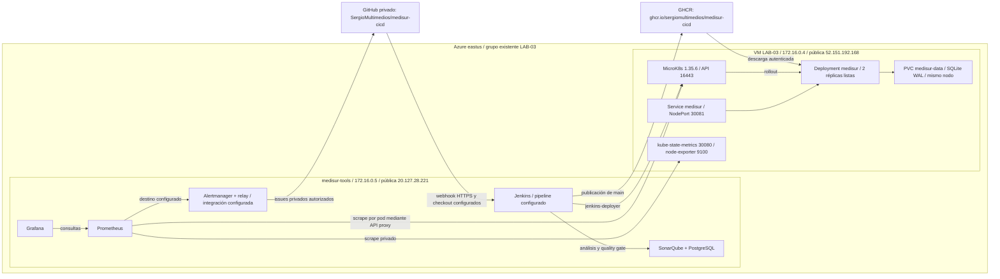

# MediSur: piloto de integración y despliegue continuo

## 1. Portada

Estado: REPORTE ESCOLAR EN REVISIÓN. El build 3 de `medisur-main` completó el despliegue y la validación automatizada fue aprobada. La recuperación de un pod y el rollback manual están demostrados; siguen pendientes la prueba de rollback automático ante un rollout fallido, la recuperación de datos y la entrega escolar.

| Dato | Contenido |
| --- | --- |
| Materia | Cómputo en la nube |
| Proyecto | MediSur CI/CD sobre dos máquinas virtuales de Azure |
| Institución, grupo y docente | Pendientes de completar |
| Integrantes y matrículas | Pendientes de completar; no se infieren de cuentas o correos |
| Roles del equipo | Pendiente asignar responsables de aplicación, infraestructura, CI/CD, monitoreo y documentación |
| Corte del borrador | 19 de noviembre de 2026 |
| Repositorio privado | https://github.com/SergioMultimedios/medisur-cicd |
| Revisión del equipo | Pendiente; incluye validar resultados, autoría declarada y explicación oral |

Distingo la evidencia guardada de los resultados comunicados por el responsable. La [validación automatizada](live-validation.json), del `2026-11-19T18:20:10.624927Z` al `2026-11-19T18:20:11.145892Z`, registra `success: true`. La [demostración negativa del gate](quality-gate.json) y la [recuperación aprobada](evidence/recovery-verified.json), con `status: passed`, documentan resultados separados. Conservo el [ensayo bloqueado anterior](evidence/recovery.json) como antecedente resuelto, no como estado actual. Esta revisión documental no ejecutó pruebas, consultas en vivo ni operaciones de Git.

La estructura conserva las trece secciones del borrador. Sigue pendiente cotejar sus títulos con la wiki de CI/CD; `Instructions.md`, fuera de este repositorio, corresponde al caso de consultoría y no sustituye esa rúbrica. La paginación debe revisarse al regenerar Word, sin añadir capturas ficticias para alcanzar una extensión.

## 2. Problema y objetivo

El problema que tomo del caso MediSur es la falta de control sobre los cambios: una aplicación puede funcionar y, aun así, no existir una relación comprobable entre su código, las pruebas, la versión instalada y su estado operativo. En este piloto busco demostrar esa relación con una API pequeña, no reproducir la plataforma clínica de la empresa.

El objetivo es relacionar un cambio de código con sus pruebas, análisis de calidad, imagen y versión instalada. El build 2 fue el primer éxito desde un push real; el build 3 corresponde a la versión actual de dos réplicas, restituida tras el ensayo manual. La demostración aislada confirmó que una cobertura insuficiente detiene el pipeline aunque las pruebas pasen. La eliminación de un pod y el rollback manual ya tienen evidencia; falta provocar un rollout fallido para probar la recuperación automática. El inventario y las reglas de alerta ayudan a ubicar el componente afectado; configurarlas no demuestra que haya ocurrido un incidente.

La aplicación contiene seis operaciones HTTP, contando por separado los dos métodos de `/api/items`:

| Operación | Comportamiento leído en `app/__init__.py` |
| --- | --- |
| `GET /health` | Confirma que el proceso responde con `status=ok`; no comprueba SQLite |
| `GET /ready` | Consulta el esquema de SQLite y devuelve 503 si se fuerza indisponibilidad |
| `GET /version` | Expone `version`, `git_sha` y `build_date` |
| `GET /metrics` | Publica contador de solicitudes e histograma de duración |
| `GET /api/items` | Lista los registros almacenados |
| `POST /api/items` | Acepta solamente `name`, asigna UUID y devuelve 201 |

Los nombres se recortan y deben tener entre 1 y 120 caracteres, sin NUL. El cuerpo está limitado a 16 KiB. No hay autenticación de usuarios en esta API. Por ello limito la práctica a datos sintéticos y acceso controlado; no la presento como un sistema apto para pacientes.

## 3. Arquitectura

Se reutiliza la VM `LAB-03` para MicroK8s y se agrega `medisur-tools` para las herramientas. Ambas están en Azure, región `eastus`, dentro del grupo existente `LAB-03`, según la verificación comunicada por el responsable. Las conexiones entre herramientas y clúster están configuradas con direcciones privadas.

El diagrama representa las integraciones configuradas al corte: GitHub → webhook HTTPS → Jenkins → Sonar y GHCR → MicroK8s. Prometheus descubre ambos pods y tiene Alertmanager configurado; la prueba sintética del canal abrió y cerró un issue privado. Las flechas indican conexiones, no garantías de disponibilidad. Las copias PNG y drawio se actualizan por separado del Mermaid incluido en este reporte.

El endpoint público https://medisur-sergio-cicd.eastus.cloudapp.azure.com/github-webhook/ recibe exclusivamente webhooks; no publica la API ni las interfaces administrativas. La verificación comunicada identificó nginx 1.18 de Ubuntu y certificado HTTPS con vencimiento el 17/02/2027. Una firma HMAC incorrecta produjo 401, y `/admin` y `/login` devolvieron 404. El hook GitHub `714127126` registró ping y push reales con HTTP 200.

En `infra/tools/compose.yaml`, Jenkins, SonarQube, Prometheus y Grafana se publican sobre `127.0.0.1`, en 8080, 9000, 9090 y 3000. Los túneles SSH activos al corte permiten usar http://localhost:18080 para Jenkins, http://localhost:19000 para Sonar, http://localhost:13000 para Grafana, http://localhost:19090 para Prometheus y http://localhost:18000 para la aplicación privada. El último reenvía al NodePort privado `172.16.0.4:30081`.

El [README](../README.md#runbook-breve) incluye el comando de túnel y la consulta local de credenciales por SSH. El usuario de las VM es `username`; la clave local se referencia como `../LAB-03_key.pem` desde el proyecto y no se incorpora al repositorio. Jenkins y Grafana usan `medisur-admin`; Sonar usa `admin`. Sus contraseñas se consultan solo en terminal privada desde `/etc/medisur/secrets/`, nunca se copian a documentación, capturas o video. Las funciones ya configuradas —interfaces por túnel, webhook, avisos, presupuesto y apagados— no requieren acceso al portal de Azure para su uso habitual.

Las dos réplicas de la API comparten un PVC local. `k8s/app/deployment.yaml` exige la etiqueta de nodo `medisur.io/sqlite-node=true` y usa `RollingUpdate`, con `maxUnavailable: 0` y `maxSurge: 1`. Ese tercer pod temporal requiere capacidad disponible durante una actualización. No hay alta disponibilidad de nodo. La caída de `LAB-03` afecta a ambas réplicas y al almacenamiento.

## 4. Inventario de infraestructura y versiones

Uso «informado» para los resultados de verificación aportados al encargo y «declarado» para las versiones escritas en archivos. No confundo la etiqueta de una imagen con una versión observada en ejecución.

| Componente | Capacidad o versión | Fuente y estado al corte |
| --- | --- | --- |
| VM `LAB-03` | `Standard_D2as_v4`, 2 vCPU, 8 GB RAM, Ubuntu 24.04 | Informado como verificado; recurso preexistente |
| Disco raíz de `LAB-03` | Premium, 30 GB; aproximadamente 23 GB libres en la comprobación informada | No es una lectura actual ni una reserva garantizada |
| MicroK8s | 1.35.6; RBAC ahora habilitado y almacenamiento habilitado | Informado; RBAC estaba deshabilitado al inicio |
| VM `medisur-tools` | `Standard_D4s_v4`, 4 vCPU, 16 GB RAM, Ubuntu 22.04 | Informado como creado; sustituyó la opción B4ms bloqueada por cuota |
| Disco de `medisur-tools` | Standard SSD, 64 GB | Informado como verificado |
| Imagen de aplicación | Base `python:3.14.10-slim-bookworm`, fijada por digest; publicación `0.1.0-f04534bb54d0` | GHCR privado informado; SHA y versión finales corroborados en recovery-verified.json, revisión 4; digest de publicación por adjuntar |
| API y servidor | Flask 3.1.3, Gunicorn 27.0.1, prometheus-client 0.26.0 | Declarados en `requirements.txt` |
| Pruebas | pytest 9.2.0, pytest-cov 7.1.0, coverage 7.17.3 | Declarados; el XML de cobertura identifica coverage 7.17.3 |
| Jenkins | Core 2.580.2; imagen `medisur/jenkins:security-verified-20261119`; 85 plugins fijados | Cotejo en ejecución comunicado a las 18:15 UTC: 85/85 activos, habilitados y con versiones exactas; sin discrepancias |
| SonarQube y base auxiliar | SonarQube `25.12.0.117093-community`; PostgreSQL `17.7-bookworm` | Imágenes declaradas y fijadas por digest en Compose |
| Scanner y cliente Kubernetes | Imagen scanner `11.1.1.1661_6.2.1`; kubectl `v1.34.3` por defecto | Etiqueta de imagen leída en Jenkinsfile; no se confunde con la versión binaria del scanner instalado en Jenkins |
| Observabilidad | Prometheus v3.8.0, Grafana 12.3.1; node-exporter de herramientas v1.10.2 | Imágenes declaradas en Compose; siete targets `up` en la instantánea |
| Exportador del nodo Kubernetes | Paquete Ubuntu `prometheus-node-exporter` 1.7.0-1ubuntu0.3 | Versión efectiva informada; no es 1.10.2 como el exportador de herramientas |
| Estado Kubernetes | kube-state-metrics v2.15.0 | Declarado en `k8s/monitoring/kube-state-metrics.yaml` |
| Alertmanager y relay | Imagen Alertmanager v0.28.1 fijada por digest; relay `medisur/alert-relay:0.1.0` | Compose separado `infra/alerting/compose.yaml`; ambos saludables según verificación comunicada, sin puertos publicados |
| Docker Engine, Compose y SQLite | Versiones efectivas pendientes de capturar | No deducidas del sistema operativo ni de la versión de Python |

Jenkins 2.528.3 corresponde a la fase anterior. `docs/jenkins-security.md` documenta la construcción y verificación aislada de la imagen nueva, antes de su integración; sus frases sobre un controlador aún sin actualizar son históricas. El Compose actual selecciona la imagen nueva y JCasC ya usa `crumbIssuer: standard`. El cotejo posterior del controlador con volumen persistente confirmó las 85 versiones fijadas. No acredita ausencia general de vulnerabilidades.

## 5. CMDB inicial

Registro componentes lógicos, no cada pod efímero. Así puedo asociar un incidente con un despliegue, un volumen o una herramienta sin rehacer el inventario después de cada actualización. Los responsables funcionales siguientes son propuestas; los nombres personales y su aceptación siguen pendientes.

| CI | Elemento y ubicación | Dependencia principal | Responsable propuesto | Estado / evidencia |
| --- | --- | --- | --- | --- |
| CI-01 | Grupo Azure `LAB-03`, eastus | Suscripción de laboratorio | Infraestructura | Existencia informada; contiene recursos previos |
| CI-02 | VM `LAB-03`, 172.16.0.4 | CI-01, disco raíz y red | Infraestructura | VM y capacidad informadas |
| CI-03 | MicroK8s de `LAB-03` | CI-02 | Plataforma | Versión y activación RBAC informadas |
| CI-04 | VM `medisur-tools`, 172.16.0.5 | CI-01, SSD y red | Infraestructura | Herramientas operativas y acceso SSH informado |
| CI-05 | GitHub privado `SergioMultimedios/medisur-cicd` | Cuenta propietaria y acceso privado | Código y cambios | Push y hook real verificados; `main` sin protección por 403 |
| CI-06 | Jenkins; job `medisur-main`, ejecutor `medisur-ci` | CI-04, Docker, CI-05, credenciales | CI/CD | Core 2.580.2; build 3 `SUCCESS`; 85/85 plugins cotejados según verificación comunicada |
| CI-07 | SonarQube y PostgreSQL auxiliar | CI-04, volúmenes y credencial de base | Calidad | Gate `OK`, cobertura 93.9 %, bugs 0, vulnerabilidades 0 |
| CI-08 | Imagen `ghcr.io/sergiomultimedios/medisur-cicd` | CI-06 y CI-07 | CI/CD | Privada; etiqueta publicada `0.1.0-f04534bb54d0`; digest final por adjuntar |
| CI-09 | Deployment y Service `medisur` | CI-03, CI-08, CI-10 | Aplicación | Dos réplicas listas y `/version` coincidente verificados |
| CI-10 | PVC `medisur-data`, 2 Gi, namespace `medisur` | Hostpath de CI-02 y permisos UID/GID 10001 | Plataforma / datos | Declarado en bootstrap; no demuestra backup |
| CI-11 | Prometheus y exportadores | CI-03, CI-04, identidad `prometheus-tools` | Monitoreo | Siete targets `up`; tasas, CPU y memoria de ambos pods actuales en JSON |
| CI-12 | Grafana y dos dashboards | CI-11 | Monitoreo | Ambos registrados; capturas finales de paneles pendientes |
| CI-13 | Alertmanager y relay a issues | CI-11, CI-05, secretos privados | Incidentes | Ambos saludables; issue sintético #1 abierto y cerrado automáticamente |
| CI-14 | Presupuesto mensual y apagados | CI-01, CI-02, CI-04 | Costos | 50 USD/mes; 05:00 UTC ambas VM; gasto MTD reportado 5.4832853475 USD, aún incompleto |

Para mantener esta CMDB propongo actualizar estado, versión y evidencia después de cada cambio aceptado. No afirmo que exista sincronización automática. El commit desplegado debe acompañar los incidentes de CI-09; la revisión de CI-10 debe distinguir recuperación de aplicación de recuperación de datos.

## 6. Pipeline y control de cambios

En `Jenkinsfile` leo una secuencia de siete etapas. La identidad del ejecutor es `medisur-ci`, se deshabilitan builds concurrentes y el timeout global es de 45 minutos.

1. `Checkout`: limpia el workspace, obtiene el commit completo y valida herramientas, scripts y renderizado Kustomize. La versión prevista tiene forma `0.1.0-<12 caracteres del SHA>`.
2. `Unit tests and coverage`: construye la imagen de pruebas, recupera `junit.xml` y `coverage.xml` y conserva el código de salida de la prueba.
3. `SonarQube analysis`: envía código e informe de cobertura al servidor sin copiar `.git` ni archivos de credenciales Jenkins.
4. `Quality gate`: espera hasta diez minutos el resultado y aborta si no lo aprueba. El umbral de cobertura debe configurarse en el servidor; un comentario en el repositorio no lo establece.
5. `Build runtime image`: construye la imagen de ejecución con versión, SHA completo y fecha UTC.
6. `Publish main image`: publica en GHCR solamente cuando la identificación de rama corresponde a `main` y no es una solicitud de cambio.
7. `Deploy main and smoke test`: aplica la versión usando `medisur-kubeconfig` y ejecuta la comprobación posterior. Esta etapa agrupa despliegue y verificación, no son dos etapas Jenkins distintas.

El build 3 de `medisur-main` comenzó el `2026-11-19T18:17:25.309Z` y terminó el `2026-11-19T18:19:17.046Z`: las horas se obtienen del timestamp y duración de [live-validation.json](live-validation.json). Registra las siete etapas en `SUCCESS`, además de `Declarative: Post Actions`: son ocho entradas en la API, no ocho etapas funcionales del Jenkinsfile. La ejecución se puede consultar por túnel en http://localhost:18080/job/medisur-main/3/.

La publicación actual corresponde al SHA completo `f04534bb54d0a16472ea97009fcebc409e43fb8c` y a `ghcr.io/sergiomultimedios/medisur-cicd:0.1.0-f04534bb54d0`, informada como privada. [recovery-verified.json](evidence/recovery-verified.json) corrobora `/version`, imagen y dos réplicas listas y disponibles en la revisión Kubernetes 4, después de restituir esa versión. [recovery.json](evidence/recovery.json) conserva la revisión 2 anterior al ensayo; los números de revisión Kubernetes no son números de build Jenkins. Los cambios documentales posteriores no se presuponen desplegados.

Conservo como antecedente el build 2: primer éxito disparado por push GitHub, de `2026-11-19T18:13:40Z` a `2026-11-19T18:15:05Z`, con SHA `6fc0a30fbeba3e19127b868abbcf28d3a3854fff` y etiqueta `0.1.0-6fc0a30fbeba`. No es la versión actual.

`pyproject.toml` exige cobertura mínima de 60 % en pytest. El gate de Sonar observado también exige 60 % y devuelve `OK` con 93.9 %; registra bugs 0 y vulnerabilidades 0. La instantánea conserva un code smell y un hallazgo sin resolver: gate aprobado no significa cero hallazgos. En ejecución, `app/gunicorn.conf.py` mantiene un worker con cuatro hilos por réplica para conservar un registro de métricas por proceso.

`scripts/deploy.sh` comprueba que imagen, etiqueta y SHA coincidan. Si existe una versión anterior, verifica que funcione antes de modificarla; después hace un dry-run de servidor, aplica el manifiesto y espera el rollout. Ante un fallo intenta volver a la revisión anterior y verificarla. El build permanece fallido aunque la recuperación funcione. En el primer despliegue no existe revisión previa a la cual regresar, y un rollback no revierte SQLite.

Ese rollback automático está implementado y cubierto por pruebas con mocks; no ha sido probado ante un rollout fallido en vivo. El ensayo aprobado demuestra un rollback manual con kubectl local y la restitución posterior de la versión actual, no la activación automática de esa rama del pipeline.

La comprobación `scripts/verify.sh` exige dos réplicas actualizadas, disponibles y listas, revisa imagen y anotaciones de los pods y consulta salud, readiness, versión y listado. La consulta HTTP por Service no demuestra por sí sola que `/version` se haya leído en cada pod; se complementa con la inspección del estado Kubernetes. Estas comprobaciones no crean registros.

Hay un requisito formal sin cumplir: la protección de `main`. El responsable informó una respuesta 403 por requerir GitHub Pro para esa configuración en el repositorio privado. No describo la rama como protegida ni afirmo revisiones obligatorias o bloqueos de merge efectivos. El push y el build existen; no resuelven esa restricción.

El Jenkinsfile actual usa `withSonarQubeEnv('SonarQube')`, igual que `infra/tools/jenkins/jenkins.yaml`. La discrepancia anterior del nombre está corregida; el build exitoso aporta evidencia de la integración. Los comentarios históricos no sustituyen estos valores efectivos.

La demostración negativa quedó registrada en [quality-gate.json](quality-gate.json), recogido a las `2026-11-19T18:18:30.797922Z`. El build 2 del job manual aislado `medisur-quality-demo` terminó `FAILURE`: sus 35 pruebas pasaron sin fallos ni omisiones y el análisis Sonar terminó `SUCCESS`, pero la cobertura deliberadamente reducida a 37.7 % incumplió el mínimo de 60 %. Sonar devolvió `ERROR` y Jenkins abortó el pipeline por ese gate. Bugs y vulnerabilidades permanecieron en cero.

La verificación comunicada confirma que `Would publish` quedó omitida y no hubo publicación ni despliegue. La API de etapas la representa como `FAILED` con el mismo error propagado del gate, no como un estado literal `SKIPPED`. El ensayo usa código sin cobertura en un proyecto separado; no degrada la aplicación desplegada. El error inicial de Groovy quedó corregido y no forma parte de la evidencia de rechazo por calidad.

## 7. Monitoreo y respuesta a incidentes

La configuración de Prometheus evalúa reglas y recolecta métricas cada 30 segundos. La instantánea registra siete targets `up`: Prometheus, exportadores de ambas VM, kube-state-metrics en `172.16.0.4:30080`, cAdvisor y dos pods de aplicación mediante la API de MicroK8s. El scrape distingue pod y versión: no usa el NodePort balanceado para mezclar contadores de procesos distintos. Los cinco servicios centrales de herramientas —Jenkins, SonarQube, PostgreSQL, Prometheus y Grafana— se complementan con node-exporter; no se confunde ese inventario con el número de targets.

Grafana registra `Medisur - Infrastructure` y `Medisur - Application`. El primero incluye CPU, memoria, disco, réplicas, reinicios y salud de targets. El segundo incluye solicitudes por segundo, respuestas 5xx, latencia p95, versión, CPU y memoria por pod. La captura de las 18:20 UTC contiene `app_rps`, CPU y memoria de ambos pods actuales, además de dos réplicas listas frente a dos deseadas. Para los sufijos `sfsh4` y `c55xg`, la CPU registrada es aproximadamente 0.0002161 y 0.0002189 cores, y la memoria de trabajo es 51,859,456 y 51,834,880 bytes, respectivamente.

También aparecen series de la revisión anterior en la captura posterior al rollout. No significan cuatro réplicas activas: los targets actuales de aplicación son dos. Las tasas de los pods actuales son 0 y aproximadamente 0.005807 solicitudes/s; no representan una prueba de carga ni permiten concluir sobre latencia p95. El registro de dashboards y estas consultas no sustituyen las capturas finales de sus paneles.

La renovación de credenciales Kubernetes está instalada en `medisur-tools` mediante [`medisur-credentials.timer`](../infra/credentials/medisur-credentials.timer), habilitado y activo según la verificación comunicada. Programa renovación horaria, al arranque y recuperación de ejecuciones omitidas. La última renovación fue `2026-11-19T18:17:09.198913Z`, con vigencia de tokens de 24 horas y ocho pruebas focalizadas aprobadas. El mecanismo usa SSH privado con comando forzado, actualiza solamente la credencial `medisur-kubeconfig` en Jenkins sin alterar jobs y conserva los archivos montados por Prometheus. El [runbook](../README.md#runbook-breve) incluye consultas de estado; `verify-live.py` fuerza una rotación y no debe confundirse con una lectura pasiva.

| Regla en `infra/monitoring/prometheus/rules.yml` | Condición declarada | Primera revisión operativa propuesta |
| --- | --- | --- |
| `DiskUsageAbove80Percent` | Espacio no disponible superior a 80 % durante 5 minutos, en filesystem escribible | Revisar uso y rotación; no borrar volúmenes de datos |
| `MedisurFrequentRestarts` | Más de 3 reinicios en 10 minutos | Revisar eventos, última imagen y límites de memoria |
| `MedisurReplicasNotReady` | Réplicas listas por debajo de deseadas durante 5 minutos | Revisar readiness, PVC, pull de imagen y capacidad del nodo |
| `MonitoringTargetDown` | `up == 0` durante 5 minutos | Revisar proceso, conectividad, CA y vigencia de credencial |
| `MedisurDiscoveryEmpty` | Ausencia de targets del job `medisur` durante 5 minutos | Revisar token, RBAC, anotaciones y pods en ejecución |

Las tres primeras reglas cubren disco, reinicios y réplicas de la aplicación; las otras dos vigilan el monitoreo. Son condiciones configuradas, no cinco incidentes observados. `infra/monitoring/prometheus/prometheus.yml` ya define `alertmanager:9093` como destino. Alertmanager y relay se despliegan por separado mediante `infra/alerting/compose.yaml`, sin puertos publicados; ambos se reportaron saludables.

La prueba sintética del canal abrió y cerró automáticamente https://github.com/SergioMultimedios/medisur-cicd/issues/1, identificado con la etiqueta `TEST`. No fue una caída real ni demuestra que las tres condiciones operativas hayan llegado a dispararse desde Prometheus. La prueba acredita apertura y resolución del aviso de prueba; queda separada del ensayo controlado de recuperación de pod y rollback manual.

El relay recibe alertas, conserva estado en SQLite y comprueba que el repositorio sea privado antes de actuar. Sus límites están documentados en su README: no ofrece una garantía distribuida de entrega exactamente una vez y un resultado remoto incierto puede requerir reconciliación manual. Las etiquetas no deben contener secretos ni datos clínicos, aunque exista sanitización.

Para cada incidente propongo registrar CI afectado, hora, alerta, versión, acción aplicada y prueba de recuperación. Si vuelve la misma causa, debe abrirse un registro de problema. Este procedimiento es una propuesta de operación; el ensayo controlado mide recuperación, pero no constituye un historial de incidentes reales ni permite estimar un tiempo medio de recuperación.

## 8. Declaración de uso de inteligencia artificial

Este borrador y la preparación técnica incluyen asistencia de Cortex Code, con el modelo `openai-gpt-6-astra`. No atribuyo al estudiante la escritura manual de material generado por el asistente. La revisión del equipo y la capacidad de explicar y defender cada decisión siguen siendo pendientes de la entrega.

| Material asistido o generado | Revisión que puedo acreditar en este corte | Ajuste o límite identificado |
| --- | --- | --- |
| API, pruebas y Dockerfile preparados con asistencia | Lectura de código, pruebas y XML existentes | Se diferencian salud y readiness; la API carece de autenticación y no debe tratar datos clínicos |
| Pipeline, scripts y manifiestos preparados con asistencia | Build 3 y etapas en JSON; gate negativo, recuperación de pod y rollback manual demostrados; 85/85 plugins cotejados según verificación comunicada | Rollback automático implementado, no probado ante fallo en vivo; restauración de datos no demostrada |
| Monitoreo, renovación y relay preparados con asistencia | Siete targets, CPU/memoria y dashboards en JSON; renovación e issue sintético comunicados | El aviso de prueba no se atribuye a un incidente real; no hay prueba de carga |
| Reporte y README actualizados con asistencia | Contraste con JSON de validación, gate y ambos ensayos de recuperación, además de hechos suministrados; revisión anti-slop | Validación `success: true` y recuperación `passed` dentro de su alcance; no equivalen a entrega escolar completa ni atribuyen operaciones al estudiante |
| Decisiones de capacidad y costos | Aprobación del responsable para D4s_v4 y presupuesto; consulta MTD comunicada | No equivale a aprobación docente ni a una factura completa de herramientas |

No utilicé IA para fabricar capturas, resultados de pipeline, nombres de integrantes o facturas. La tabla describe la revisión del asistente; no acredita una revisión humana que todavía no se ha registrado. Antes de entregar, el equipo debe completar qué revisó, qué cambió y qué pruebas puede reproducir.

## 9. Evidencias y pruebas

La evidencia actual registra 35 pruebas aprobadas en el build 3, cero fallos y cero omisiones. Como evidencia separada, `tests/reports/junit.xml` contiene 35 pruebas, cero errores, cero fallos y cero omisiones, con timestamp `2026-11-19T11:26:48.667190-06:00`. Ese XML local no se atribuye al build 3 ni a una ejecución de esta actualización documental.

La verificación local comunicada por el flujo principal reportó 99 pruebas Python aprobadas: 35 de aplicación, 8 de configuración de herramientas, 39 del relay, 9 del webhook y 8 de credenciales. También pasaron 10 pruebas shell con mocks de despliegue, para 109 casos locales en total. No sumo las 35 del build ni las 35 de la demostración negativa a ese total: son ejecuciones distintas. Los mocks no acreditan un rollback automático provocado por un fallo real del clúster.

En `tests/reports/coverage.xml` aparecen 141 líneas cubiertas de 147 y 14 ramas cubiertas de 18. Esto corresponde a 95.92 % de líneas y 77.78 % de ramas. La cobertura combinada con ramas activadas es `(141 + 14) / (147 + 18) × 100 = 93.94 %`. No es correcto llamar a esta última cifra «93.94 % de ramas».

Los tests incluyen rechazo de entradas inválidas, persistencia entre instancias, errores de base, marcadores de readiness y métricas con etiquetas acotadas. En la prueba de concurrencia, dos procesos realizan 30 escrituras cada uno sobre la misma base local y verifican 60 UUID distintos e integridad SQLite. Esto prueba ese escenario local; no demuestra rendimiento ni persistencia del PVC en Azure.

La [recolección actual](live-validation.json) terminó con `success: true`, `errors: []` y `failures: []`, de `18:20:10.624927` a `18:20:11.145892` UTC. Registra build 3 y todas sus etapas exitosas, 35 pruebas aprobadas, gate `OK`, cobertura Sonar 93.9 %, bugs 0, vulnerabilidades 0, siete targets saludables, consultas de tasas/CPU/memoria con datos y dos dashboards. El defecto histórico del parser JUnit y la falta inicial de muestras CPU quedaron superados en esta nueva evidencia.

El alcance del recolector declara que Sonar y Prometheus son consultas al estado del momento, sin correlación automática demostrada con el build. [quality-gate.json](quality-gate.json) aporta por separado el rechazo deliberado por cobertura. [recovery-verified.json](evidence/recovery-verified.json) aporta el estado final y `/version`; la privacidad GHCR y la causa del webhook del primer éxito proceden de la verificación comunicada. Los pods de la captura de monitoreo de las 18:20 UTC son anteriores al ensayo y no se confunden con los pods finales.

La [recuperación verificada](evidence/recovery-verified.json) comenzó a las `2026-11-19T18:23:11.242544Z` y terminó a las `18:27:03.766555Z` con estado `passed`. Mediante **kubectl local**, no mutaciones por SSH, se eliminó un solo pod y se recuperaron dos réplicas listas en **21.623 s**. El UID eliminado fue reemplazado; esto no implica un incremento de `restartCount`. El sondeo de readiness tiene resolución de dos segundos y el tiempo incluye latencia de API.

El monitor HTTP registró **51 solicitudes, 51 éxitos y 0 fallos** por el túnel de la computadora. El JSON configura intervalo de 0.5 s, máximo de 200 solicitudes y límite de 120 s; las latencias observadas hicieron que solo se obtuvieran 51 muestras. No fueron 200 solicitudes ni una prueba de carga. Los cero fallos se limitan a esa ventana y ruta: no demuestran disponibilidad para todos los clientes ni continuidad HTTP durante todo el rollback.

El rollback manual solicitó volver al contenido de la revisión 1 y creó la revisión **3**, con SHA `6fc0a30fbeba3e19127b868abbcf28d3a3854fff`, dos réplicas listas y `/version` coincidente en **46.206 s**. Después se restituyó el contenido de la revisión 2, creando la revisión **4**, SHA `f04534bb54d0a16472ea97009fcebc409e43fb8c`, con dos réplicas listas y disponibles y `/version` confirmado. Esto demuestra recuperación de pod, rollback manual y restitución de la versión de aplicación; no rollback de SQLite, restauración de backup ni tolerancia a caída de nodo.

Conservo [recovery.json](evidence/recovery.json) sin alterar como antecedente: de `18:21:18.803502` a `18:21:30.898179` UTC, la API local `https://52.151.192.168:16443` agotó el tiempo de espera y no hubo mutaciones. Sus contadores en cero indican ensayo no iniciado. Según la verificación comunicada por el flujo principal, después se actualizó la regla NSG para permitir la IP del operador; el acceso local funcionó y permitió el ensayo aprobado. El diagnóstico original no verificó la causa exacta, y no se reescribe como si lo hubiera hecho. El bloqueo ya no es el estado actual.

| Evidencia | Estado al corte | Qué falta para cerrar |
| --- | --- | --- |
| E-01: infraestructura Azure | Datos de VM, RBAC y almacenamiento informados como verificados | Adjuntar salida o captura fechada y saneada |
| E-02: pytest y cobertura | Build 3: 35 aprobadas; verificación local comunicada: 99 Python + 10 mocks shell aprobados; Sonar 93.9 % | Adjuntar artefactos locales con su procedencia, sin atribuirlos a otro build |
| E-03: repositorio y protección | Push real y SHA publicados; repositorio privado; protección bloqueada con 403 | Resolución o dispensa formal de protección y acceso docente autorizado |
| E-04: pipeline y Sonar | Build 3 y etapas `SUCCESS`; gate `OK`; demo 2 rechazada por 37.7 % < 60 %; 85/85 plugins cotejados según verificación comunicada | Conservar ambos JSON y adjuntar constancia saneada del cotejo |
| E-05: imagen GHCR | Imagen privada `0.1.0-f04534bb54d0` y SHA actual documentados | Adjuntar digest de publicación a la evidencia final |
| E-06: Kubernetes | Estado final: revisión 4, SHA actual, dos réplicas listas y `/version` coincidente | Demostrar persistencia de datos en vivo |
| E-07: recuperación | `passed`: pod recuperado en 21.623 s; 51 HTTP exitosas/0 fallidas; rollback manual en 46.206 s y versión actual restituida | Probar rollback automático ante rollout fallido en vivo y restauración de backup; no confundirlos con el rollback manual demostrado |
| E-08: observabilidad y alertas | Siete targets `up`, CPU/memoria de dos pods actuales, dos dashboards; renovación horaria verificada; issue `TEST` #1 abierto y cerrado | Adjuntar paneles y constancia de renovación saneados; no presentar el aviso sintético como incidente real |
| E-09: presupuesto y apagados | 50 USD/mes, avisos 80/100 %, ambas VM 05:00 UTC; gasto MTD 5.4832853475 USD | Conservar consulta saneada y conciliar cargos tardíos de herramientas; verificar desasignación |
| E-10: demostración y documentos | DOCX, PNG y drawio ya generados; video pendiente | Regenerar DOCX, revisar vigencia del diagrama, completar video y capturas sin credenciales |

Cada evidencia final debe incluir fecha, entorno, resultado y relación con el commit cuando corresponda. No inserto imágenes vacías como si fueran capturas. Los XML locales pueden quedar excluidos del repositorio por las reglas de artefactos: se deben adjuntar mediante el mecanismo de entrega elegido, sin asumir que estarán visibles en GitHub.

## 10. Decisiones, desviaciones y riesgos

La reutilización de `LAB-03` evita reemplazar una VM existente, pero conserva Ubuntu 24.04 y un disco raíz Premium de 30 GB, no 32 GB. `medisur-tools` usa Ubuntu 22.04 y Standard SSD de 64 GB. Los tamaños efectivos son D2as_v4 y D4s_v4, no serie B. No los describo como servidores idénticos ni como cumplimiento literal de la consigna. La elección de Ubuntu, tamaños y discos requiere aprobación docente pendiente.

El tamaño B4ms se descartó por bloqueo de cuota de la suscripción. El responsable aprobó explícitamente D4s_v4 y su costo de referencia. Esa autorización permite la preparación, pero no demuestra que el tamaño esté optimizado: faltan mediciones de CPU y memoria durante un build completo y con Sonar en funcionamiento.

SQLite usa WAL, `synchronous=FULL`, transacciones `BEGIN IMMEDIATE` y espera de bloqueo. Las dos réplicas deben compartir un filesystem local con permisos de escritura para UID/GID 10001, incluyendo archivos WAL y SHM. No propongo NFS para este diseño. Un PVC persistente no es una copia de seguridad y no hay restauración demostrada. El marcador `NOT_READY` sobre el volumen compartido puede afectar a ambas réplicas; una simulación debe prever ese alcance.

El Dockerfile de aplicación tiene dos etapas y termina con usuario no root `10001:10001`. El manifiesto agrega raíz de solo lectura, eliminación de capabilities y token de ServiceAccount sin montaje automático. Cada réplica solicita 100m de CPU y 128 Mi de memoria, con límites de 500m y 256 Mi. Estos son límites declarados, no consumo observado.

La identidad `jenkins-deployer` está limitada al namespace `medisur`: puede modificar deployments, services y configmaps, y leer los objetos necesarios para verificar. No tiene lectura directa de Secrets ni escritura de RBAC en el manifiesto. Aun así, poder modificar un Deployment puede permitir acceso indirecto a secretos montables en ese namespace. No equivale a aislamiento frente a un pipeline hostil.

La credencial de GitHub autorizada durante la instalación también se utiliza para GHCR y el relay de alertas. Tiene permisos de repositorio y publicación de paquetes: el Secret `ghcr-pull` no contiene una credencial de solo lectura. Separar estas funciones con credenciales de menor alcance queda como mejora de seguridad; no lo presento como privilegio mínimo completo. La reversión implementada restaura el Deployment, no los datos ni cambios independientes de Service. Una reconstrucción del mismo commit puede volver a publicar su etiqueta; para producción fijaría además el digest de la imagen.

Hay dos riesgos adicionales de administración. Jenkins monta el socket Docker, cuyo acceso equivale en la práctica a control privilegiado de la VM de herramientas; no deben ejecutarse Jenkinsfiles de autores no confiables. La identidad de monitoreo tiene `get pods/proxy` y `get nodes/proxy`: el primero no se restringe a `/metrics` y el segundo concede acceso al kubelet más amplio que métricas. Son concesiones de laboratorio que deben revisarse, no presentarse como permisos exclusivamente de observación.

Las IP privadas no sustituyen reglas de red. Debe verificarse el filtrado efectivo de 9100, 30080, 30081 y 16443, así como el acceso SSH. Los secretos de Compose son archivos montados, no un almacén cifrado. Ni PAT, kubeconfig, claves SSH ni contraseñas deben aparecer en Git, comandos de entrega, capturas o video.

## 11. Costos y controles de consumo

La consulta de costos Azure del 19/11/2026, comunicada por el responsable, reporta gasto acumulado del mes (MTD): discos 3.2632853475 USD e IP 2.22 USD, para un total de 5.4832853475 USD. No es saldo de créditos. Los cargos recientes de herramientas aún no aparecen por latencia de facturación; la ausencia de un cargo no significa que el recurso sea gratuito. Esta edición no repitió la consulta.

| Concepto | Importe o condición | Interpretación |
| --- | --- | --- |
| Discos, gasto MTD reportado | 3.2632853475 USD | Consulta al 19/11/2026; no incluye todos los cargos recientes |
| IP, gasto MTD reportado | 2.22 USD | Mismo corte de consulta |
| Total MTD reportado | `3.2632853475 + 2.22 = 5.4832853475 USD` | Gasto acumulado visible; no crédito disponible ni costo final |
| Cómputo de `medisur-tools` | 0.192 USD/h de referencia | Separado del gasto observado; falta conciliar cargos tardíos y horas facturadas |
| Ejemplo de 8 horas al día por 20 días | `0.192 × 8 × 20 = 30.72 USD` | Escenario ilustrativo de esa VM; no horario real observado |
| Ejemplo continuo de 30 días | `0.192 × 24 × 30 = 138.24 USD` | Solo cómputo de D4s_v4; rebasa por sí solo el presupuesto |
| Otros cargos aún no reflejados | Sin importe final conciliado | El total reportado no cierra el costo del proyecto ni separa todo el incremento de herramientas |
| Presupuesto de `LAB-03` | 50 USD mensuales | Creado con aprobación del usuario; no constituye un tope duro |

`infra/azure/budget.json` filtra el grupo `LAB-03`, con periodo del 1 de noviembre de 2026 al 1 de febrero de 2027 y alertas de gasto real al 80 % y 100 %. El destinatario configurado es `sergio.navarro@multimedios.com`. Los umbrales equivalen a 40 y 50 USD, pero no acreditan que se haya enviado un correo. Al reutilizar el grupo, el presupuesto incluye sus recursos anteriores; no separa automáticamente el incremento de este proyecto.

Ambas VM tienen apagado programado a las 05:00 UTC, según la confirmación del encargo. Para la zona centro de México, UTC-6, corresponde a las 23:00 del día anterior. Es una hora de apagado, no 23 horas de uso, ni un encendido automático. La reducción efectiva de cómputo depende de la desasignación; los discos y otros recursos pueden seguir generando cargos.

Para el cierre falta conciliar los cargos tardíos por recurso y periodo, distinguir recursos nuevos de preexistentes y comprobar la desasignación tras el apagado. El presupuesto y ambos apagados ya están configurados y no requieren entrar al portal para funcionar. No propongo eliminar el grupo completo: `LAB-03` ya existía y puede contener recursos ajenos a esta práctica.

## 12. Conclusiones y límites

El build 3 relaciona siete etapas exitosas con una imagen y una versión servida por dos réplicas; el build 2 conserva el antecedente del primer éxito por push GitHub. Las 35 pruebas aprobadas y la validación automatizada satisfacen las comprobaciones registradas. La demostración negativa aporta un resultado distinto: las pruebas pueden pasar y el gate detener el pipeline por cobertura de 37.7 %, inferior al 60 % exigido. Aprobar el gate de la aplicación tampoco significa ausencia de defectos: queda un code smell.

La recuperación aprobada mide 21.623 s para volver a dos pods listos y 46.206 s para el rollback manual; termina con la versión actual restituida en revisión 4. Las 51 muestras HTTP no registraron fallos, pero no cubren todos los clientes ni todo el rollback. El bloqueo de conectividad anterior quedó resuelto tras la actualización NSG comunicada; ambos artefactos conservan la trazabilidad. La protección de `main` continúa sin resolver: una convención escrita no sustituye un bloqueo efectivo.

Las dos réplicas no eliminan la dependencia del nodo ni del disco. El rollback automático está implementado y cubierto por mocks, no probado ante un rollout fallido en vivo; tampoco hay restauración de datos demostrada. Para un servicio clínico, esta arquitectura y sus permisos necesitarían otra evaluación; no basta con aumentar réplicas. El cierre escolar requiere además revisión humana, video, integrantes, roles y aprobación docente de las desviaciones.

## 13. Anexos y pendientes de integración

### A. Fuentes utilizadas y entregables

La base técnica del reporte incluye `app/`, `tests/`, XML de `tests/reports/`, `Dockerfile`, requisitos, `pyproject.toml`, `sonar-project.properties`, `Jenkinsfile`, scripts, `k8s/`, `infra/tools/`, `infra/monitoring/`, `infra/alert-relay/` e `infra/azure/budget.json`. Las fuentes de resultados son [live-validation.json](live-validation.json), [quality-gate.json](quality-gate.json), [recovery.json](evidence/recovery.json) y [recovery-verified.json](evidence/recovery-verified.json); la renovación se documenta en [`infra/credentials/`](../infra/credentials/). Los hechos de Azure, actualización NSG para la IP del operador, webhook, privacidad GHCR, cotejo de plugins, renovación horaria, issue sintético y 99 pruebas Python más 10 mocks shell proceden de la verificación comunicada; no se les atribuye una consulta o ejecución nueva en esta edición.

El [README del proyecto](../README.md) contiene preparación local, acceso SSH, scripts de encendido/desasignación y comprobaciones de operación. El [README del relay](../infra/alert-relay/README.md) describe permisos, reintentos y límites. El repositorio privado https://github.com/SergioMultimedios/medisur-cicd ya contiene el push observado; falta confirmar acceso docente. Video, revisión e integración de capturas finales y copia de la wiki de CI/CD: pendientes.

En `docs/evidence/` se localizaron `jenkins-main-build-3.png`, `jenkins-main-stages.png`, `jenkins-quality-demo-tests.png`, `sonar-medisur-cicd.png`, `sonar-medisur-quality-demo.png`, `grafana-medisur-infrastructure.png` y `grafana-medisur-application.png`. Solo se comprobó su presencia: no se certifican aquí contenido, legibilidad, saneamiento ni finalización del trabajo de capturas. Esas revisiones siguen abiertas antes de incorporarlos a Word o al video.

Existen [reporte.docx](reporte.docx), [architecture.png](architecture.png) y el [diagrama editable architecture.drawio](architecture.drawio). Su existencia no acredita que incorporen este corte. El Mermaid del reporte ya refleja las integraciones configuradas; el flujo principal actualizará el diagrama físico y regenerará Word con `scripts/render-report.py`, con revisión posterior de maquetación. Esta edición se limita a `README.md` y `docs/reporte.md`.

### B. TODO documental para el cierre del despliegue

Las casillas marcadas indican hechos ya documentados; las abiertas son pendientes del cierre. Esta lista no autoriza cambios adicionales por sí misma.

- [ ] Completar portada, integrantes, roles y registro de revisión humana del uso de IA.
- [ ] Cotejar los trece títulos con la wiki y obtener aprobación docente de Ubuntu, tamaños y discos.
- [ ] Incorporar evidencia fechada de las VM, almacenamiento, RBAC, red, presupuesto y apagados.
- [x] Documentar build 3, SHA `f04534bb54d0a16472ea97009fcebc409e43fb8c`, imagen privada, dos réplicas listas y `/version` coincidente; conservar build 2 como primer éxito histórico.
- [x] Registrar webhook público HTTPS, ping/push 200 y acceso administrativo y de aplicación por túneles privados.
- [x] Corregir la discrepancia documental de Sonar: Jenkinsfile y JCasC ya usan `SonarQube`; gate observado `OK`.
- [x] Documentar Compose separado de alertas, destino Prometheus e issue sintético `TEST` #1 abierto y cerrado automáticamente.
- [x] Incorporar gasto MTD comunicado de 5.4832853475 USD, separado de crédito y de cargos tardíos de herramientas.
- [ ] Resolver el 403 de protección de `main` o documentar dispensa aceptada; no declarar protección mientras no exista.
- [x] Registrar cotejo comunicado de Jenkins 2.580.2: 85/85 plugins activos, habilitados y con versiones exactas, sin discrepancias.
- [ ] Adjuntar constancia saneada del cotejo y registrar versiones efectivas faltantes de Docker, Compose y SQLite.
- [x] Incorporar recolección `success: true`, sin errores ni fallos, con 35 pruebas, etapas exitosas y series de tasas/CPU/memoria.
- [x] Documentar demo 2: 35 pruebas aprobadas, análisis Sonar exitoso, cobertura 37.7 % < 60 %, gate `ERROR` y `Would publish` omitida; distinguir la representación `FAILED` de la API.
- [x] Documentar renovación horaria activa, última renovación 18:17:09 UTC, tokens de 24 horas y ocho pruebas focalizadas aprobadas según verificación comunicada.
- [x] Registrar 99 pruebas Python y 10 mocks shell aprobados según el flujo principal, separados de las 35 pruebas del build.
- [x] Conservar el ensayo histórico `blocked` y documentar su resolución: actualización NSG comunicada y ensayo local posterior `passed`.
- [x] Documentar recuperación de pod en 21.623 s, 51 HTTP exitosas/0 fallidas, rollback manual en 46.206 s y restitución del SHA actual como revisión 4 con dos réplicas listas.
- [ ] Probar rollback automático ante un rollout fallido en vivo; su implementación y mocks no sustituyen esa evidencia.
- [ ] Adjuntar digest GHCR y evidencia fechada del volumen; probar persistencia y restauración de backup sin confundirlas con recuperación de pod o rollback de aplicación.
- [ ] Adjuntar capturas finales de dashboards; las series CPU/tasas ya existen. Revisar permisos proxy sin exponer secretos ni llamar incidente real a la prueba sintética.
- [ ] Conciliar gasto por recurso y periodo cuando aparezcan cargos tardíos; conservar separados los ejemplos de tarifa y comprobar desasignación programada.
- [ ] Regenerar `docs/reporte.docx` desde el flujo principal tras estos cambios, revisar Word y coordinar la actualización de leyendas de PNG/drawio fuera de esta edición.
- [ ] Incorporar video y capturas saneadas; revisar las conclusiones, completar nombres, roles y revisión humana sin atribuciones ficticias.